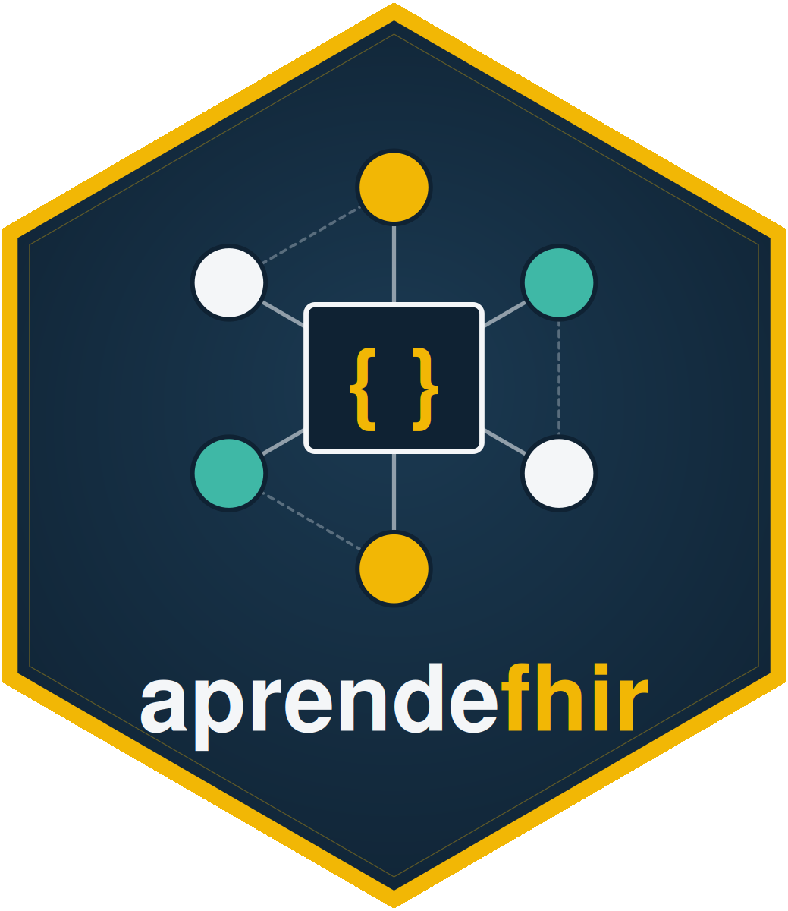
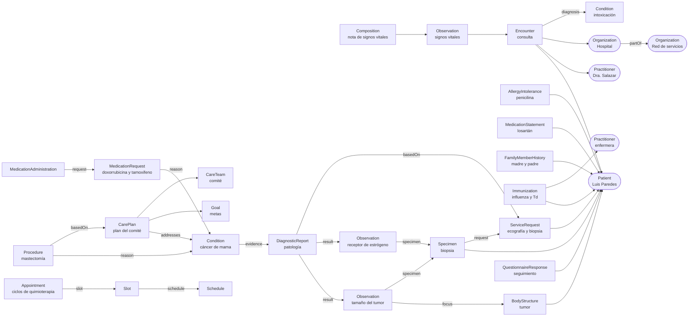

<p align="center">
  
</p>

<h1 align="center">Aprende FHIR desde cero</h1>
<p align="center"><strong>Taller práctico de HL7 FHIR R4 con un caso clínico ecuatoriano</strong></p>
<p align="center">
  <a href="https://github.com/f-slg/aprende-fhir/actions/workflows/validar.yaml"></a>
  
  
</p>
<p align="center">
  <a href="#elige-tu-camino">Empezar</a> ·
  <a href="#módulos">Módulos</a> ·
  <a href="#el-caso">El caso</a> ·
  <a href="#validar-tus-recursos">Validar</a>
</p>

---

Un recorrido para aprender FHIR haciendo, **paso a paso**: crearás, buscarás,
corregirás y enlazarás **36 tipos de recursos** siguiendo a un mismo paciente,
desde su primera consulta hasta el resumen internacional (IPS) que lleva de viaje.

En cada módulo:

- una **ficha de cada recurso**: qué es, para qué se usa, cuándo usar otro y
  sus elementos principales, con la cardinalidad y el tipo tomados de la
  especificación oficial;
- la **construcción paso a paso**: del recurso mínimo al completo, campo por
  campo, explicando cada decisión (todas las versiones intermedias son
  válidas);
- **errores a propósito**, con la respuesta real del servidor, para aprender
  a leerlos;
- autoevaluación y resumen.

- **Para quién:** profesionales de salud, epidemiólogos, estudiantes y equipos
  técnicos que se acercan por primera vez a FHIR. No hace falta saber
  programar.
- **Tres formas de practicar** con el mismo contenido: Postman, R/RStudio o
  curl.
- **Recursos validados:** las 80 soluciones y sus 133 versiones intermedias se
  revisan con el [validador oficial de HL7](https://github.com/hapifhir/org.hl7.fhir.core)
  en cada cambio, y el taller completo se ejecuta en un servidor
  [HAPI FHIR](https://hapifhir.io/).

> **Solo datos ficticios.** Las personas, las cédulas (empiezan con `99`, un
> código de provincia que no existe) y los establecimientos son inventados.
> Si usas un servidor público, todo lo que envíes será visible para
> cualquiera: nunca subas datos reales de pacientes.

## Elige tu camino

| | Ideal si... | Cómo empezar |
|---|---|---|
| **Postman** | Es tu primera vez con FHIR o no programas. Ves cada petición y cada respuesta. | Instala [Postman](https://www.postman.com/downloads/), importa [`postman/aprende-fhir.postman_collection.json`](postman/aprende-fhir.postman_collection.json) y ejecuta las peticiones en orden. Cada `POST` guarda el `id` creado para las siguientes. |
| **R / RStudio** | Trabajas con datos y quieres convertir los resultados en tablas. | Abre `aprende-fhir.Rproj`, instala `httr2` y `jsonlite`, y sigue [`r/primeros_pasos.R`](r/primeros_pasos.R). Con `source("r/taller.R")` ejecutas todo. |
| **curl** | Prefieres la terminal o quieres automatizar. | `curl/taller.sh` ejecuta todo el taller; `curl/taller.sh 05` solo hasta el módulo 05. Requiere `curl` y `jq`. |

Los tres caminos usan los mismos archivos JSON y la misma lista de pasos
([`herramientas/pasos.json`](herramientas/pasos.json)).

### Los servidores

Por defecto se usa el servidor público de HAPI FHIR:
`https://hapi.fhir.org/baseR4` (variable `FHIRURL`). El módulo 18 usa además
el servidor de terminología de HL7, `https://tx.fhir.org/r4` (variable
`TXURL`). Para cambiarlos, edita las variables en Postman, o en R y curl:

```bash
FHIRURL=http://localhost:8080/fhir curl/taller.sh
```

Si tienes Docker o Podman puedes levantar tu propio servidor en un minuto:

```bash
docker run -p 8080:8080 hapiproject/hapi:latest
```

y usar `http://localhost:8080/fhir`.

## Módulos

El taller tiene tres niveles y 19 módulos, que se siguen en orden.

**Nivel básico**

| | Módulo | Recursos | Aprendes a... |
|---|---|---|---|
| 01 | [Fundamentos](modulos/01-fundamentos/README.md) | CapabilityStatement, OperationOutcome | Qué es FHIR, los tipos de datos, la cardinalidad, la API REST y los dos tipos de error |
| 02 | [Patient](modulos/02-patient/README.md) | Patient | Construir un paciente paso a paso; crear, leer, buscar, actualizar y ver el historial |
| 03 | [Transacciones](modulos/03-transacciones/README.md) | Bundle `transaction` | Enviar varios recursos a la vez, todo o nada, sin duplicados |
| 04 | [Profesionales y organizaciones](modulos/04-profesionales-y-organizaciones/README.md) | Practitioner, Organization | Modelar a la médica y la jerarquía de establecimientos |
| 05 | [Diagnóstico y encuentro](modulos/05-diagnostico-y-encuentro/README.md) | Condition, Encounter | Codificar con CIE-10 y SNOMED CT y traer recursos con `_include` |
| 06 | [Observaciones](modulos/06-observaciones/README.md) | Observation | Signos vitales con LOINC y UCUM, y los tipos de `value[x]` |

**Nivel intermedio**

| | Módulo | Recursos | Aprendes a... |
|---|---|---|---|
| 07 | [Antecedentes](modulos/07-antecedentes/README.md) | AllergyIntolerance, MedicationStatement, FamilyMemberHistory | Registrar alergias, medicación habitual y antecedentes familiares |
| 08 | [Vacunación](modulos/08-vacunacion/README.md) | Immunization | Registrar vacunas aplicadas y diferidas, con lote y dosis del esquema |
| 09 | [Documentos clínicos](modulos/09-documentos-clinicos/README.md) | Composition, Bundle `document` | Crear un documento autocontenido e inmutable |
| 10 | [Órdenes y derivación](modulos/10-ordenes-y-derivacion/README.md) | Location, PractitionerRole, ServiceRequest | Pedir estudios, derivar y cerrar el ciclo orden → resultado con `_revinclude` |
| 11 | [Anatomía patológica](modulos/11-anatomia-patologica/README.md) | BodyStructure, Specimen, DiagnosticReport | Registrar una biopsia, corregir resultados y emitir un informe |
| 12 | [Plan y consentimiento](modulos/12-plan-y-consentimiento/README.md) | CareTeam, Goal, CarePlan, Consent | Registrar el comité de tumores, sus metas, el plan y el consentimiento informado |
| 13 | [Procedimientos](modulos/13-procedimientos/README.md) | Procedure | Registrar una cirugía con su motivo y resultado |
| 14 | [Citas](modulos/14-citas/README.md) | Schedule, Slot, Appointment, AppointmentResponse | Agendar, confirmar, cumplir y cancelar citas, y entender la caché del servidor |
| 15 | [Medicamentos](modulos/15-medicamentos/README.md) | MedicationRequest, MedicationAdministration | Prescribir, administrar y suspender un tratamiento |
| 16 | [Seguimiento](modulos/16-seguimiento/README.md) | Questionnaire, QuestionnaireResponse | Definir y responder un cuestionario, extraer datos y ver todo con `$everything` |

**Nivel avanzado**

| | Módulo | Recursos | Aprendes a... |
|---|---|---|---|
| 17 | [Búsquedas avanzadas y versiones](modulos/17-busquedas-y-versiones/README.md) | — | Tipos de parámetros, prefijos, modificadores, búsquedas encadenadas e inversas (`_has`), paginación, versiones y `If-Match` |
| 18 | [Terminologías y perfiles](modulos/18-terminologias-y-perfiles/README.md) | CodeSystem, ValueSet, StructureDefinition | `$lookup`, `$validate-code`, `$expand`, `$subsumes`; escribir un perfil y validar con `$validate` |
| 19 | [Resumen del paciente (IPS)](modulos/19-resumen-ips/README.md) | Composition IPS, Bundle `document` | Armar el IPS de Luis, usar `$document` y validar contra la guía oficial IPS |

## El caso

**Luis Alberto Paredes Cevallos**, 46 años, nacido en Riobamba y residente en
Quito, consulta en el *Hospital General Docente Ejemplo* por dolor abdominal,
náuseas y diarrea. La Dra. Andrea Salazar diagnostica una intoxicación
alimentaria y, en la anamnesis, registra su **alergia a la penicilina**, el
**losartán** que toma por hipertensión y un dato importante: **su madre tuvo
cáncer de mama**. Como Luis tiene fiebre, las vacunas se difieren; dos
semanas después recibe la de la influenza y el refuerzo de Td.

En abril, Luis se palpa un nódulo en la mama izquierda. La ecografía es
sospechosa y una biopsia confirma un **carcinoma ductal infiltrante** con
receptor de estrógeno positivo. El comité de tumores define el plan: cirugía,
quimioterapia con doxorrubicina y hormonoterapia con tamoxifeno. Los
cuestionarios de seguimiento muestran que el tamoxifeno le provoca sofocos y
dolor articular, y se suspende. En febrero de 2026, antes de viajar, Luis
recibe su **resumen internacional del paciente (IPS)**.

| Fecha | Qué pasa | Módulos |
|---|---|---|
| 20-mar-2025 | Consulta: diagnóstico, signos vitales, antecedentes, vacunas diferidas | 02 a 08 |
| 03-abr-2025 | Vacunatorio: influenza y Td | 08 |
| 22 a 28-abr-2025 | Nódulo en la mama: ecografía BI-RADS 4, orden de biopsia y derivación a oncología | 10 |
| 06 a 13-may-2025 | Biopsia, informe de patología y diagnóstico de cáncer | 11 |
| 20 y 27-may-2025 | Comité de tumores: plan, metas y consentimiento informado | 12 |
| 10-jun-2025 | Mastectomía parcial | 13 |
| jul-2025 | Citas de quimioterapia; el ciclo 2 se cancela por neutropenia | 14 |
| 02-jul-2025 | Primer ciclo de doxorrubicina | 15 |
| 15-oct-2025 → feb-2026 | Tamoxifeno, suspendido por intolerancia | 15 |
| oct-2025 y ene-2026 | Cuestionarios de seguimiento: aparecen los sofocos y el dolor articular | 16 |
| 15-feb-2026 | Resumen internacional del paciente (IPS) para su viaje | 19 |

Así se enlazan los recursos que crearás:



## Validar tus recursos

Cuando escribas tus propias soluciones, valídalas con el validador oficial de
HL7. Necesitas tener Java instalado:

```bash
herramientas/validar.sh
```

El script descarga el validador la primera vez y valida contra FHIR R4
(estructura, cardinalidades, reglas y códigos LOINC, SNOMED CT, CIE-10 y CVX)
todas las soluciones y versiones intermedias. Además comprueba que el
validador detecte cada error a propósito, y valida contra el **perfil del
taller** (módulo 18) y contra la **guía oficial IPS** (módulo 19). Agrega `--avisos` al final
para ver también las advertencias. También puedes validar un recurso suelto
en <https://validator.fhir.org/>.

## Preguntas frecuentes

**¿Por qué el servidor aceptó un recurso con errores?** Muchos servidores no
validan todo al guardar: descartan elementos desconocidos o aceptan recursos
a los que les falta algo obligatorio. El módulo 01 lo explica y cada módulo
tiene un error a propósito de cada tipo. Valida siempre tus recursos.

**¿Por qué aparece varias veces el mismo paciente?** Cada `POST` crea un
recurso nuevo. Si ejecutas el taller dos veces, tendrás dos "Luis". Es un
buen motivo para conocer la creación condicional del módulo 03.

**¿Los códigos son reales?** Sí. LOINC, SNOMED CT, CIE-10 y UCUM son las
terminologías reales, y el validador revisa cada código y su nombre. Lo
ficticio son las personas, los identificadores y los establecimientos.

**¿Los `system` de los identificadores son oficiales?** No. Usamos direcciones
didácticas (`https://f-slg.github.io/aprende-fhir/sid/...`). En un proyecto
real se usan las que defina la guía de implementación nacional.

## Estructura del repositorio

```
modulos/NN-tema/README.md       explicación, ejercicios y pistas
modulos/NN-tema/soluciones/     recursos FHIR de solución (JSON)
modulos/NN-tema/pasos/          versiones intermedias de la construcción paso a paso
modulos/NN-tema/errores/        errores a propósito
postman/                        colección de Postman
r/                              funciones y scripts para R/RStudio
curl/                           script para la terminal
herramientas/pasos.json         lista ordenada de pasos del taller (y errores esperados)
herramientas/construccion.json  qué campos agrega cada paso de la construcción
herramientas/actualizar.py      genera los pasos, las fichas y Postman
herramientas/validar.sh         validación con el validador oficial de HL7
```

Si cambias una solución, un paso o un README, ejecuta
`python3 herramientas/actualizar.py`: regenera las versiones intermedias,
rellena en los README las fichas (con la cardinalidad y el tipo de la
especificación oficial) y los bloques de cada paso, y actualiza la colección
de Postman. Después, valida con `herramientas/validar.sh`.

## Contribuir

¿Encontraste un error o tienes una idea para un módulo nuevo? Abre un
[issue](https://github.com/f-slg/aprende-fhir/issues). Las propuestas de
mejora son bienvenidas.

## Licencia y aviso

- El contenido del taller (textos, casos y recursos JSON) se distribuye bajo
  [CC BY 4.0](https://creativecommons.org/licenses/by/4.0/deed.es): puedes
  usarlo y adaptarlo citando la fuente.
- El código (scripts de R, curl y herramientas) se distribuye bajo
  [licencia MIT](LICENSE).

HL7® y FHIR® son marcas registradas de Health Level Seven International. Este
taller es un proyecto educativo independiente y no implica afiliación ni aval
de HL7.

Autor: **Dr. Fabricio Salas Guerrero** · [LinkedIn](https://www.linkedin.com/in/fslg/) ·
[Más proyectos](https://github.com/f-slg)
